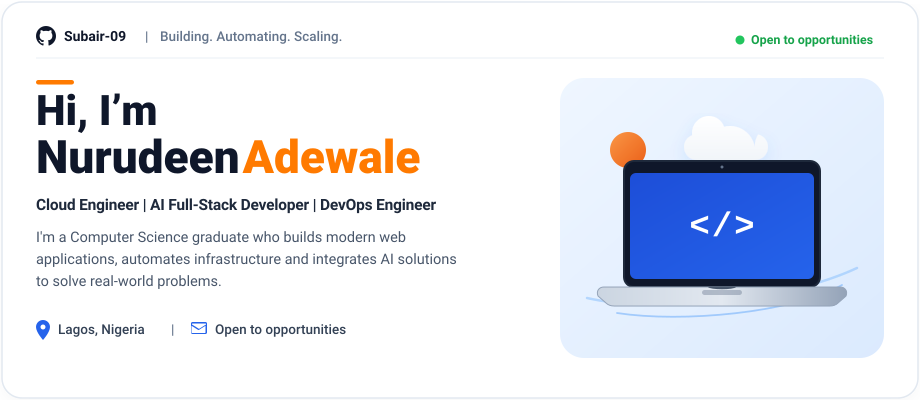
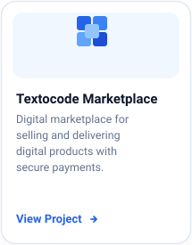
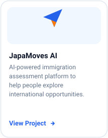
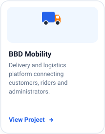
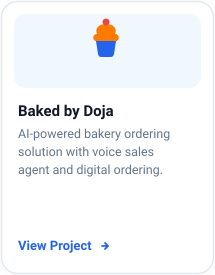
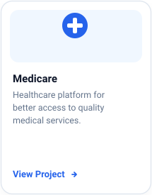
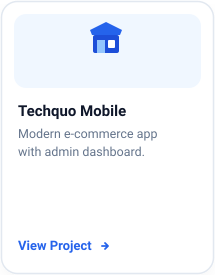
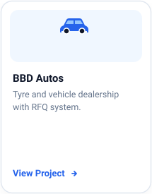

  <!-- HERO BANNER -->
  

 

<!-- ==================== TECH STACK ==================== -->
<table>
  <tr>
    <td width="70%" align="left" style="border:none;">
      <h3>⚡ &nbsp;Tech Stack</h3>
    </td>
    <td width="30%" align="right" style="border:none;">
      <a href="https://github.com/Subair-09?tab=repositories"><b>View all skills ➔</b></a>
    </td>
  </tr>
</table>

   &nbsp;
   &nbsp;
   &nbsp;
   &nbsp;
   &nbsp;
   &nbsp;
   &nbsp;
  

 

<!-- ==================== FEATURED PROJECTS ==================== -->
<table>
  <tr>
    <td width="70%" align="left" style="border:none;">
      <h3>📁 &nbsp;Featured Projects</h3>
    </td>
    <td width="30%" align="right" style="border:none;">
      <a href="https://github.com/Subair-09?tab=repositories"><b>View all projects ➔</b></a>
    </td>
  </tr>
</table>

<table width="100%" border="0" cellspacing="8" cellpadding="0">
  <tr>
    <td width="25%" align="center" valign="top">
      
    </td>
    <td width="25%" align="center" valign="top">
      
    </td>
    <td width="25%" align="center" valign="top">
      
    </td>
    <td width="25%" align="center" valign="top">
      
    </td>
  </tr>
</table>

 

<!-- ==================== MORE PROJECTS ==================== -->
<table>
  <tr>
    <td width="70%" align="left" style="border:none;">
      <h3>⭐ &nbsp;More Projects</h3>
    </td>
    <td width="30%" align="right" style="border:none;">
      <a href="https://github.com/Subair-09?tab=repositories"><b>Explore more ➔</b></a>
    </td>
  </tr>
</table>

<table width="100%" border="0" cellspacing="8" cellpadding="0">
  <tr>
    <td width="25%" align="center" valign="top">
      
    </td>
    <td width="25%" align="center" valign="top">
      
    </td>
    <td width="25%" align="center" valign="top">
      
    </td>
    <td width="25%" align="center" valign="top">
      
    </td>
  </tr>
</table>

 

<!-- ==================== LET'S CONNECT ==================== -->
<table>
  <tr>
    <td width="60%" align="left" style="border:none;">
      <h3>🚀 &nbsp;Let's Connect</h3>
    </td>
    <td width="40%" align="right" style="border:none;">
      Collaborate &nbsp;•&nbsp; Build &nbsp;•&nbsp; Create Impact
    </td>
  </tr>
</table>

   &nbsp;
   &nbsp;
   &nbsp;
  

 

<!-- ==================== FOOTER ==================== -->

  

 

<!-- ==================== ACCESSIBILITY & TEXT INDEXING ==================== -->

  
<b>📖 View Project Summaries in Plain Text</b>

   

  - **[Textocode Marketplace](https://github.com/Subair-09/textocode)**: Digital marketplace for selling and delivering digital products with secure payments.
  - **[JapaMoves AI](https://github.com/Subair-09/japamoves)**: AI-powered immigration assessment platform to help people explore international opportunities.
  - **[BBD Mobility](https://github.com/Subair-09/bbdmobility)**: Delivery and logistics platform connecting customers, riders and administrators.
  - **[Baked by Doja](https://github.com/Subair-09/baked-by-Doja-)**: AI-powered bakery ordering solution with voice sales agent and digital ordering.
  - **[Medicare](https://github.com/Subair-09/Medicare-)**: Healthcare platform for better access to quality medical services.
  - **[Techquo Mobile](https://github.com/Subair-09/TechquoMobileApp)**: Modern e-commerce app with admin dashboard.
  - **[BBD Autos](https://github.com/Subair-09/bbdautos)**: Tyre and vehicle dealership with RFQ system.
  - **[CaseMind](https://github.com/Subair-09/casemind)**: AI-powered case management solution for lawyers & businesses.

